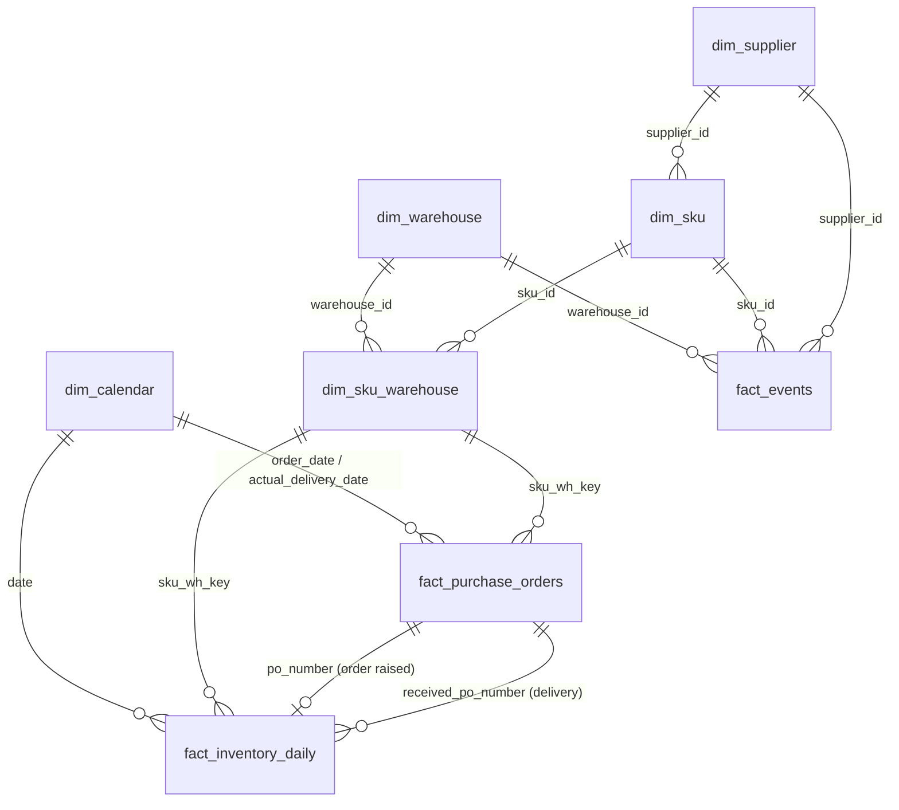

# Pharmaceutical Warehouse Inventory Dataset 

---

A large-scale, realistic **synthetic dataset representing the warehouse and inventory operations of an Indian pharmaceutical distribution company**. The dataset is structured as a **star-style relational data model**, comprising fact and dimension tables that represent key business entities and operational processes across the pharmaceutical supply chain.

The dataset is designed to support comprehensive **Python-based Exploratory Data Analysis (EDA)** and **Power BI analytics**, covering demand and supply patterns, inventory levels, replenishment and reorder behaviour, supplier performance, service levels, stock movements, batch and expiry management, inventory risk, and working-capital efficiency.

It also enables advanced inventory-management analysis, including **ABC-XYZ classification, safety-stock analysis, reorder-point optimization, Economic Order Quantity (EOQ), inventory turnover, demand variability, and periodic versus continuous review policies**.

The dataset is intended for **data analytics, business intelligence, research analysis, inventory optimization, and supply-chain decision-making use cases**, providing an end-to-end environment for evaluating how data-driven approaches can improve pharmaceutical inventory availability while reducing stockouts, excess inventory, expiry-related losses, and procurement inefficiencies.

---

**Period:** 2024-01-01 to 2025-12-31 (731 days) | **Warehouses:** 5 | **SKUs:** 60 in 10 therapeutic categories | **Suppliers:** 8 | **Currency:** INR

---

## 1. Files

| File | Rows | Grain | Purpose |
|---|---|---|---|
| `fact_inventory_daily.csv` | 219,300 | date x warehouse x SKU | Daily inventory snapshot: one row per date x warehouse x SKU (219,300 rows). Stock movement, planning parameters, orders raised, service and financial KPIs. |
| `fact_purchase_orders.csv` | 7,612 | one purchase order | One row per purchase order raised (7,612 rows): ordered vs received quantities, promised vs actual lead time, delays and short shipments. |
| `fact_events.csv` | 60 | one event | Disruption and demand-shock events behind the daily flags (60 rows): 26 disease outbreaks, 30 tender/promo bursts, 4 supplier disruptions. |
| `dim_sku_warehouse.csv` | 300 | warehouse x SKU | One row per SKU-warehouse combination (300 rows): policy, segment and planning attributes that stay constant over the period. |
| `dim_sku.csv` | 60 | SKU | Product master (60 rows). |
| `dim_warehouse.csv` | 5 | warehouse | Warehouse master (5 rows). |
| `dim_supplier.csv` | 8 | supplier | Supplier master (8 rows). |
| `dim_calendar.csv` | 731 | date | Date dimension (731 rows, 2024-01-01 to 2025-12-31). |
| `data_dictionary.csv` | 142 | column | Every column of every table with type, key and description (machine-readable version of section 5) |
| `example_joins.py` | - | - | Runnable Python examples of the main joins |
| `README.md` | - | - | This document |

## 2. Data model



### Keys and how to join

| From | Column | To | Column | Relationship |
|---|---|---|---|---|
| fact_inventory_daily | `date` | dim_calendar | `date` | many-to-one |
| fact_inventory_daily | `warehouse_id` | dim_warehouse | `warehouse_id` | many-to-one |
| fact_inventory_daily | `sku_id` | dim_sku | `sku_id` | many-to-one |
| fact_inventory_daily | `supplier_id` | dim_supplier | `supplier_id` | many-to-one |
| fact_inventory_daily | `sku_wh_key` | dim_sku_warehouse | `sku_wh_key` | many-to-one (one row per SKU-warehouse) |
| fact_inventory_daily | `po_number` | fact_purchase_orders | `po_number` | one-to-one: the PO raised that day |
| fact_inventory_daily | `received_po_number` | fact_purchase_orders | `po_number` | PO(s) delivered that day (see note below) |
| fact_purchase_orders | `order_date`, `actual_delivery_date` | dim_calendar | `date` | many-to-one |
| fact_purchase_orders | `warehouse_id`, `sku_id`, `supplier_id`, `sku_wh_key` | dimensions | same names | many-to-one |
| dim_sku | `supplier_id` | dim_supplier | `supplier_id` | many-to-one |
| dim_sku_warehouse | `warehouse_id`, `sku_id` | dim_warehouse, dim_sku | same names | many-to-one |
| fact_events | `warehouse_id`, `sku_id`, `supplier_id`, `start_date`, `end_date` | dimensions | same names | many-to-one (blank where not applicable) |

**Linking an order to its delivery.** A PO appears twice in the daily table: on its order date (`po_number`) and on its delivery date (`received_po_number`). The same link also works through the purchase-order table: `fact_purchase_orders.actual_delivery_date` + `warehouse_id` + `sku_id` equals the daily row's `date` + `warehouse_id` + `sku_id`. On 2 days two POs for the same SKU-warehouse arrived together; their numbers are joined with `;` in `received_po_number` (use `.str.split(";").explode()` to separate them).

**Keys.** `sku_wh_key` = `warehouse_id` + `-` + `sku_id` (e.g. `WH-MUM-SKU0001`) so SKU-warehouse joins need one column instead of two. Dates are text in `YYYY-MM-DD`; use `parse_dates` when reading.

### Join recipes

```python
import pandas as pd
inv = pd.read_csv("fact_inventory_daily.csv", parse_dates=["date"])
sku = pd.read_csv("dim_sku.csv"); wh = pd.read_csv("dim_warehouse.csv")
cal = pd.read_csv("dim_calendar.csv", parse_dates=["date"])
dsw = pd.read_csv("dim_sku_warehouse.csv"); po = pd.read_csv("fact_purchase_orders.csv")

# Daily inventory enriched with product, warehouse, calendar and strategy attributes
full = (inv.merge(sku.drop(columns="supplier_id"), on="sku_id")
           .merge(wh[["warehouse_id", "city", "region"]], on="warehouse_id")
           .merge(cal[["date", "month", "indian_season", "day_of_week"]], on="date")
           .merge(dsw[["sku_wh_key", "abc_xyz_segment", "inventory_policy", "recommended_strategy"]], on="sku_wh_key"))

# Orders with their supplier's promised performance
po_sup = po.merge(pd.read_csv("dim_supplier.csv"), on="supplier_id")
```

`example_joins.py` contains five complete, tested examples (seasonality, segment x region stockouts, supplier promised-vs-actual, order-to-delivery tracing, disruption impact).

---

## 3. How the data was generated

The data comes from a **day-by-day inventory simulation** (not independent random numbers), so the tables agree with each other.

1. **Demand** = base demand x warehouse size x seasonality x yearly trend x weekday factor x events x random noise.
   - *Seasonality:* antibiotics, gastro and dermatology peak in the monsoon; respiratory and influenza vaccines peak in winter.
   - *Weekday effect:* Sunday demand is roughly 45% of a normal weekday.
   - *Events* (all listed in `fact_events`): 26 disease outbreaks (1.5x-2.6x demand), 30 tender/promo bursts (1.6x-2.4x), 4 supplier disruptions (planning lead time x1.6, actual lead time x2.0).
2. **Replenishment** runs daily from a 28-day trailing demand forecast:
   - Safety stock `z x sqrt(LT x sigma_d^2 + d^2 x sigma_LT^2)`; reorder point `forecast x lead time + safety stock`; EOQ with a 22% annual holding rate.
   - **A and B items:** continuous review (s,Q), ordering up to the max level when the inventory position reaches the reorder point. **C items:** periodic review every 14 days.
3. **Supply:** each PO gets a random actual lead time (supplier mean and SD, stretched during disruptions); some deliveries are short-shipped according to supplier reliability; quantities are rounded to case size and MOQ.
4. **Losses:** expiry write-offs rise with excess days of cover relative to shelf life; cold-chain items can suffer rare temperature excursions.

## 4. Data quality notes and checks

All of these were tested on the final CSV files:

- Every primary key is unique and **every foreign key resolves** (zero orphan rows) across all tables.
- Each of the 7,612 POs appears exactly once as an order row in `fact_inventory_daily` (same date, warehouse and quantity). 7,485 were delivered and **127 were still in transit** at 2025-12-31 (blank delivery fields, `po_status` = "Open - in transit at period end").
- Delivered quantities reconcile: total `received_qty` in the PO table equals total `receipts_qty` in the daily table (78,202,893 units).
- The three event flags in the daily table can be rebuilt exactly from `fact_events`.
- Stock identity holds on every row: `opening_stock + receipts_qty - issued_qty - expired_writeoff_qty - cold_chain_excursion_loss_qty = closing_stock`; `demand_qty = issued_qty + unfulfilled_qty`.
- No duplicates, no negatives, whole-number quantities. Blanks are by design: no PO / no delivery on a day, open POs, and event fields that do not apply to an event type.
- Lost demand is **not** back-ordered (`unfulfilled_qty`). Expiry is approximated from days of cover versus shelf life, not tracked batch by batch.
- `is_late` is strict (any day beyond the planned lead time), so about 38% of delivered POs count as late; use `delay_days` for finer thresholds.
- 23 of 60 SKUs are class A (38%) because ABC is value-based, not the textbook 20%.
- The data is clean on purpose. For a cleaning exercise, inject missing values, duplicates or outliers yourself.

### Changes from version 1 (single wide file)

Previously everything was in one 73-column file. **All original values are unchanged** (verified column by column). The wide file is now split:

| Version 1 column(s) | Now found in |
|---|---|
| `warehouse_city`, `region` | `dim_warehouse` via `warehouse_id` |
| `product_name`, `category`, `dosage_form`, `storage_condition`, `shelf_life_months`, `case_size`, `unit_cost_inr`, `unit_price_inr`, `abc_class` | `dim_sku` via `sku_id` |
| `supplier_name` | `dim_supplier` via `supplier_id` |
| `year`, `month`, `quarter`, `day_of_week`, `is_weekend`, `indian_season` | `dim_calendar` via `date` |
| `inventory_policy`, `review_period_days`, `service_level_target`, `xyz_class`, `abc_xyz_segment`, `demand_cv_weekly`, `recommended_strategy` | `dim_sku_warehouse` via `sku_wh_key` |
| `expected_delivery_date` | `fact_purchase_orders` via `po_number` |

New: `fact_purchase_orders`, `fact_events`, `dim_calendar`, `dim_warehouse`, `dim_sku_warehouse`, `sku_wh_key`, `received_po_number`. Renamed files: `sku_master.csv` -> `dim_sku.csv`, `supplier_master.csv` -> `dim_supplier.csv`, `pharma_warehouse_inventory_dataset.csv` -> `fact_inventory_daily.csv`. Columns renamed in `dim_sku`: `margin` -> `markup_pct`, `base_daily_demand` -> `base_daily_demand_per_wh`. In `dim_supplier`: `lt_mean`, `lt_sd`, `reliability` -> `planned_lead_time_mean_days`, `lead_time_sd_days`, `delivery_reliability`.

## 5. Column dictionary

### fact_inventory_daily

Daily inventory snapshot: one row per date x warehouse x SKU (219,300 rows). Stock movement, planning parameters, orders raised, service and financial KPIs.

| # | Column | Type | Key | Explanation |
|---|---|---|---|---|
| 1 | `record_id` | int | **PK** | Unique row number |
| 2 | `date` | text | FK -> `dim_calendar.date` | Snapshot date (YYYY-MM-DD) |
| 3 | `sku_wh_key` | text | FK -> `dim_sku_warehouse.sku_wh_key` | Single-column key = warehouse_id + '-' + sku_id (e.g. WH-MUM-SKU0001) |
| 4 | `warehouse_id` | text | FK -> `dim_warehouse.warehouse_id` | Warehouse code |
| 5 | `sku_id` | text | FK -> `dim_sku.sku_id` | Product code |
| 6 | `supplier_id` | text | FK -> `dim_supplier.supplier_id` | Supplier of the SKU (single-sourced) |
| 7 | `opening_stock` | int |  | Units at start of day (= previous day's closing_stock) |
| 8 | `receipts_qty` | int |  | Units received from suppliers that day (0 if none) |
| 9 | `received_po_number` | text | FK -> `fact_purchase_orders.po_number` | PO(s) delivered that day; two POs are joined with ';' on the 2 days where they arrived together; blank if no delivery |
| 10 | `po_qty_ordered_on_receipt` | int |  | Total quantity originally ordered on the PO(s) delivered that day (compare with receipts_qty) |
| 11 | `receipt_lead_time_days` | int (nullable) |  | Actual lead time of the PO delivered that day; blank on days without delivery (on the 2 double-arrival days it is the later PO's) |
| 12 | `demand_qty` | int |  | Customer demand for the day |
| 13 | `issued_qty` | int |  | Units actually shipped (limited by stock) |
| 14 | `unfulfilled_qty` | int |  | Demand not served (lost sales, not back-ordered) |
| 15 | `expired_writeoff_qty` | int |  | Units written off for expiry |
| 16 | `cold_chain_excursion_loss_qty` | int |  | Units lost to temperature excursions (cold-chain items) |
| 17 | `closing_stock` | int |  | Units at end of day |
| 18 | `on_order_qty` | int |  | Quantity on open POs at end of day (includes a PO raised that day) |
| 19 | `inventory_position` | int |  | closing_stock + on_order_qty |
| 20 | `inventory_position_at_review` | int |  | Position before that day's new order; the value compared with reorder_point by the reorder rule |
| 21 | `forecast_daily_demand_28d` | float |  | Trailing 28-day average daily demand |
| 22 | `demand_std_28d` | float |  | Trailing 28-day standard deviation of daily demand |
| 23 | `expected_lead_time_days` | float |  | Planning lead time that day (inflated during supplier disruption) |
| 24 | `safety_stock` | int |  | Buffer stock = z x sqrt(LT x sigma_d^2 + d^2 x sigma_LT^2) |
| 25 | `reorder_point` | int |  | Forecast demand over lead time + safety stock |
| 26 | `eoq_qty` | int |  | Economic order quantity (at least MOQ) |
| 27 | `max_stock_level` | int |  | Order-up-to level (reorder_point + eoq_qty) |
| 28 | `reorder_triggered` | int |  | 1 if a PO was raised that day |
| 29 | `po_number` | text | FK -> `fact_purchase_orders.po_number` | PO raised that day; blank if none |
| 30 | `order_qty` | int |  | Quantity ordered that day (0 if none) |
| 31 | `order_value_inr` | float |  | order_qty x unit cost |
| 32 | `ordering_cost_inr` | float |  | Fixed cost of raising the PO (only on order days) |
| 33 | `stockout_flag` | int |  | 1 if any demand went unfulfilled |
| 34 | `days_of_cover` | float |  | closing_stock / forecast_daily_demand_28d |
| 35 | `fill_rate_daily` | float |  | issued_qty / demand_qty (1 if no demand) |
| 36 | `stock_status` | text |  | Stockout / Critical (below safety stock) / Below reorder point / Healthy / Overstock (>60 days cover) |
| 37 | `stock_value_inr` | float |  | closing_stock x unit cost |
| 38 | `sales_value_inr` | float |  | issued_qty x unit price |
| 39 | `cogs_inr` | float |  | issued_qty x unit cost |
| 40 | `lost_sales_value_inr` | float |  | unfulfilled_qty x unit price |
| 41 | `writeoff_value_inr` | float |  | (expired + cold-chain loss units) x unit cost |
| 42 | `holding_cost_inr` | float |  | Daily holding cost at 22% per year of stock value |
| 43 | `outbreak_flag` | int |  | 1 on days covered by a Disease Outbreak row in fact_events for this warehouse and category |
| 44 | `tender_promo_flag` | int |  | 1 on days covered by a Tender/Promo Burst row in fact_events for this warehouse and SKU |
| 45 | `supplier_disruption_flag` | int |  | 1 on days covered by a Supplier Disruption row in fact_events for this SKU's supplier |
| 46 | `latest_batch_no` | text |  | Most recently received batch (OPENING-STOCK until the first receipt) |
| 47 | `latest_batch_expiry_date` | text |  | Expiry date of that batch |
| 48 | `days_to_expiry_latest_batch` | int |  | Days from date to that expiry |
| 49 | `recommended_action` | text |  | Rule-based daily action: Expedite PO / transfer, Raise replenishment order, Pause ordering / transfer out / liquidate, Prioritise FEFO / near-expiry clearance, No action |

### fact_purchase_orders

One row per purchase order raised (7,612 rows): ordered vs received quantities, promised vs actual lead time, delays and short shipments.

| # | Column | Type | Key | Explanation |
|---|---|---|---|---|
| 1 | `po_number` | text | **PK** | PO identifier, format `PO-WH-yymmdd-SKU` (e.g. PO-BLR-240108-0039) |
| 2 | `sku_wh_key` | text | FK -> `dim_sku_warehouse.sku_wh_key` | warehouse_id + '-' + sku_id |
| 3 | `warehouse_id` | text | FK -> `dim_warehouse.warehouse_id` | Receiving warehouse |
| 4 | `sku_id` | text | FK -> `dim_sku.sku_id` | Product |
| 5 | `supplier_id` | text | FK -> `dim_supplier.supplier_id` | Supplier |
| 6 | `order_date` | text | FK -> `dim_calendar.date` | Date the PO was raised (matches fact_inventory_daily.date where po_number is set) |
| 7 | `ordered_qty` | int (nullable) |  | Units ordered |
| 8 | `unit_cost_inr` | float |  | Unit cost used to value the order |
| 9 | `ordered_value_inr` | float |  | ordered_qty x unit_cost_inr |
| 10 | `expected_lead_time_days` | float |  | Planning lead time at order date |
| 11 | `expected_delivery_date` | text |  | order_date + expected lead time (rounded to whole days) |
| 12 | `actual_lead_time_days` | int (nullable) |  | Actual days from order to delivery; blank for open POs |
| 13 | `actual_delivery_date` | text | FK -> `dim_calendar.date` | Delivery date; blank for open POs |
| 14 | `delay_days` | int (nullable) |  | actual lead time - expected lead time (days); positive = late |
| 15 | `is_late` | int (nullable) |  | 1 if delay_days > 0; blank for open POs |
| 16 | `received_qty` | int (nullable) |  | Units delivered (can be less than ordered); blank for open POs |
| 17 | `received_value_inr` | float |  | received_qty x unit_cost_inr |
| 18 | `short_shipped_qty` | int (nullable) |  | ordered_qty - received_qty |
| 19 | `fill_rate` | float |  | received_qty / ordered_qty |
| 20 | `is_short_shipped` | int (nullable) |  | 1 if received_qty < ordered_qty |
| 21 | `supplier_disruption_at_order` | int |  | 1 if the supplier was in a disruption window when the PO was placed |
| 22 | `po_status` | text |  | Received, or Open - in transit at period end (127 POs whose delivery falls after 2025-12-31) |

### fact_events

Disruption and demand-shock events behind the daily flags (60 rows): 26 disease outbreaks, 30 tender/promo bursts, 4 supplier disruptions.

| # | Column | Type | Key | Explanation |
|---|---|---|---|---|
| 1 | `event_id` | text | **PK** | Event identifier (EV001...) |
| 2 | `event_type` | text |  | Disease Outbreak / Tender/Promo Burst / Supplier Disruption |
| 3 | `start_date` | text | FK -> `dim_calendar.date` | First day of the event |
| 4 | `end_date` | text | FK -> `dim_calendar.date` | Last day of the event |
| 5 | `duration_days` | int |  | Length in days |
| 6 | `warehouse_id` | text | FK -> `dim_warehouse.warehouse_id` | Affected warehouse (outbreaks and tender bursts; blank for supplier disruptions) |
| 7 | `category` | text |  | Affected therapeutic category (outbreaks: all SKUs of that category at that warehouse) |
| 8 | `sku_id` | text | FK -> `dim_sku.sku_id` | Affected SKU (tender/promo bursts only) |
| 9 | `supplier_id` | text | FK -> `dim_supplier.supplier_id` | Affected supplier (supplier disruptions only; applies to all that supplier's SKUs at every warehouse) |
| 10 | `demand_multiplier` | float |  | Demand uplift factor during the event (outbreaks, bursts) |
| 11 | `planning_lead_time_multiplier` | float |  | Factor by which planning lead time was inflated (supplier disruptions) |
| 12 | `actual_lead_time_multiplier` | float |  | Factor applied to actual delivery lead time (supplier disruptions) |

### dim_sku_warehouse

One row per SKU-warehouse combination (300 rows): policy, segment and planning attributes that stay constant over the period.

| # | Column | Type | Key | Explanation |
|---|---|---|---|---|
| 1 | `sku_wh_key` | text | **PK** | warehouse_id + '-' + sku_id |
| 2 | `warehouse_id` | text | FK -> `dim_warehouse.warehouse_id` | Warehouse |
| 3 | `sku_id` | text | FK -> `dim_sku.sku_id` | Product |
| 4 | `supplier_id` | text | FK -> `dim_supplier.supplier_id` | Supplier |
| 5 | `abc_class` | text |  | A/B/C by annual consumption value (same as dim_sku.abc_class) |
| 6 | `xyz_class` | text |  | X stable / Y moderate / Z erratic demand, from demand_cv_weekly (40/40/20 split) |
| 7 | `abc_xyz_segment` | text |  | Combined segment, e.g. AX, BZ |
| 8 | `demand_cv_weekly` | float |  | Coefficient of variation of weekly demand over the full period |
| 9 | `inventory_policy` | text |  | Policy simulated: Continuous Review (s,Q) for A/B, Periodic Review (R,S) for C |
| 10 | `review_period_days` | int |  | Review interval (0 = continuous, 14 = periodic) |
| 11 | `service_level_target` | float |  | Target service level: A 98.5%, B 95%, C 90% |
| 12 | `recommended_strategy` | text |  | Suggested strategy for the ABC-XYZ segment |
| 13 | `base_daily_demand_units` | float |  | Baseline daily demand at this warehouse before seasonality, trend and events |
| 14 | `planned_lead_time_days` | int |  | Mean planned lead time = supplier mean + warehouse extra transit days |

### dim_sku

Product master (60 rows).

| # | Column | Type | Key | Explanation |
|---|---|---|---|---|
| 1 | `sku_id` | text | **PK** | Product code |
| 2 | `product_name` | text |  | Generic drug name with strength/pack |
| 3 | `category` | text |  | Therapeutic category |
| 4 | `dosage_form` | text |  | Tablet, Capsule, Vial, Inhaler, Syrup, etc. |
| 5 | `storage_condition` | text |  | Ambient / Cold Chain 2-8C / Controlled |
| 6 | `shelf_life_months` | int |  | Labelled shelf life |
| 7 | `case_size` | int |  | Units per case; orders are multiples of this |
| 8 | `moq_cases` | int |  | Minimum order quantity in cases |
| 9 | `unit_cost_inr` | float |  | Landed cost per unit (INR) |
| 10 | `unit_price_inr` | float |  | Selling price per unit (INR) |
| 11 | `markup_pct` | float |  | (price - cost) / cost, as a fraction |
| 12 | `base_daily_demand_per_wh` | float |  | Average baseline daily demand per warehouse before warehouse size factor |
| 13 | `demand_volatility` | float |  | Noise level (CV) used for daily demand in the simulation |
| 14 | `order_cost_inr` | int |  | Fixed cost per PO (INR) |
| 15 | `supplier_id` | text | FK -> `dim_supplier.supplier_id` | Single supplier of the SKU |
| 16 | `abc_class` | text |  | A/B/C by annual consumption value |

### dim_warehouse

Warehouse master (5 rows).

| # | Column | Type | Key | Explanation |
|---|---|---|---|---|
| 1 | `warehouse_id` | text | **PK** | Warehouse code |
| 2 | `warehouse_name` | text |  | Warehouse name |
| 3 | `city` | text |  | City / location |
| 4 | `state` | text |  | State |
| 5 | `region` | text |  | West / North / South / East |
| 6 | `latitude` | float |  | Approximate latitude |
| 7 | `longitude` | float |  | Approximate longitude |
| 8 | `demand_size_factor` | float |  | Demand scale vs a reference warehouse (1.0) |
| 9 | `extra_transit_days` | int |  | Days added to supplier lead time for this warehouse |
| 10 | `cold_chain_enabled` | bool |  | True if the warehouse stocks 2-8C products |

### dim_supplier

Supplier master (8 rows).

| # | Column | Type | Key | Explanation |
|---|---|---|---|---|
| 1 | `supplier_id` | text | **PK** | Supplier code |
| 2 | `supplier_name` | text |  | Supplier name |
| 3 | `planned_lead_time_mean_days` | int |  | Mean quoted lead time (days) |
| 4 | `lead_time_sd_days` | float |  | Standard deviation of lead time (days) |
| 5 | `delivery_reliability` | float |  | Probability a delivery is complete; otherwise 55-95% of the order is shipped |
| 6 | `cold_chain_capable` | bool |  | True if the supplier can ship 2-8C products |

### dim_calendar

Date dimension (731 rows, 2024-01-01 to 2025-12-31).

| # | Column | Type | Key | Explanation |
|---|---|---|---|---|
| 1 | `date` | text | **PK** | Calendar date |
| 2 | `year` | int32 |  | Year |
| 3 | `quarter` | int32 |  | Quarter 1-4 |
| 4 | `month` | int32 |  | Month 1-12 |
| 5 | `month_name` | text |  | Month name |
| 6 | `week_of_year` | int |  | ISO week number |
| 7 | `day_of_month` | int32 |  | Day of month |
| 8 | `day_of_week` | text |  | Day name |
| 9 | `day_of_week_num` | int32 |  | Monday = 1 ... Sunday = 7 |
| 10 | `is_weekend` | int |  | 1 for Saturday/Sunday |
| 11 | `is_month_end` | int |  | 1 on the last day of a month |
| 12 | `indian_season` | text |  | Winter (Dec-Feb), Summer (Mar-May), Monsoon (Jun-Sep), Post-monsoon (Oct-Nov) |
| 13 | `festive_dip_flag` | int |  | 1 for 20-26 October each year, when the simulation applies a 10% demand dip |

## 6. Suggested EDA questions

1. **Demand:** monthly and weekday demand by category and season; effect of outbreaks and tender bursts (join `fact_events` or use the flags).
2. **Supply:** lead-time distribution by supplier; promised reliability vs actual fill rate; late share and delay by supplier; effect of disruptions on lead time and stockouts.
3. **Reorder behaviour:** order frequency, size and value by ABC class and policy; gap between `inventory_position_at_review` and `reorder_point`; planned vs actual lead time.
4. **Service level:** stockout rate by category, warehouse and ABC-XYZ segment; relation of safety stock to lead-time variability.
5. **Efficiency:** days of cover and inventory turnover (`cogs_inr` vs average `stock_value_inr`) by segment; holding vs ordering cost.
6. **Wastage:** write-off value by category, storage condition and days of cover.
7. **Strategy:** compare `recommended_strategy` with actual performance per segment; count `recommended_action` values over time and by warehouse.

